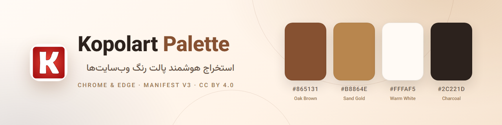
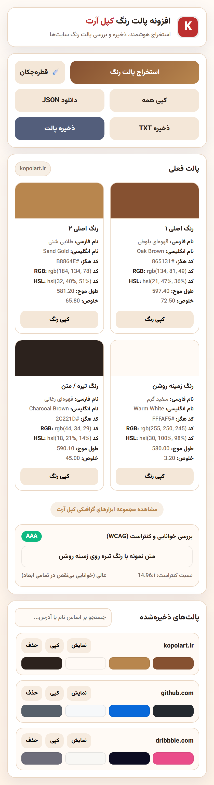
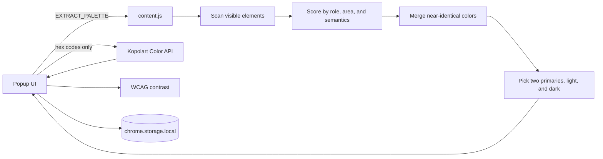

<p align="center">
  
</p>

<h1 align="center">پالت رنگ کپل‌آرت</h1>

<p align="center">
  <strong>پالت رنگ هر وب‌سایت را استخراج، ذخیره و بررسی کنید.</strong><br />
  نام فارسی رنگ، طول موج و خلوص از API کپل‌آرت — همراه با بررسی کنتراست WCAG — در یک پنجره.
</p>

<p align="center">
  <a href="LICENSE"></a>
  <a href="src/manifest.json"></a>
  <a href="#پشتیبانی-مرورگرها"></a>
  <a href="https://kopolart.ir"></a>
</p>

<p align="center"><a href="README.md">English</a> · <strong>فارسی</strong></p>

---

«پالت رنگ کپل‌آرت» یک افزونه کروم و اج است که استایل‌های محاسبه‌شده صفحه را
می‌خواند و آن‌ها را به چهار رنگ کاربردی تبدیل می‌کند: دو رنگ اصلی، یک رنگ
زمینه روشن و یک رنگ تیره برای متن. هر رنگ با نام فارسی و انگلیسی، طول موج
غالب و خلوص از API کپل‌آرت غنی می‌شود و سپس از نظر کنتراست WCAG بررسی
می‌شود.

این افزونه برای طراحان، توسعه‌دهندگان فرانت‌اند و کارشناسان دسترسی‌پذیری
ساخته شده است؛ کسانی که می‌خواهند بدون باز کردن DevTools پالت دقیق یک صفحه را
ببینند.

## تصویر افزونه

<p align="center">
  
</p>

## امکانات

- **استخراج آگاه از نقش رنگ** — رنگ‌ها بر اساس نقش پس‌زمینه، متن و حاشیه،
  مساحت دیده‌شده، معنای المان، نشانه‌های کلاس و role، گرادیان‌ها و رنگ‌های SVG
  امتیاز می‌گیرند، نه فقط بر اساس تعداد تکرار.
- **چهار نقش مفید** — دو رنگ اصلی متمایز، یک رنگ سطح روشن و یک رنگ تیره برای
  متن؛ رنگ‌های تقریباً یکسان قبل از انتخاب ادغام می‌شوند.
- **اطلاعات رنگ کپل‌آرت** — افزودن نام فارسی، نام انگلیسی، طول موج و خلوص برای
  هر رنگ.
- **بررسی کنتراست WCAG** — نمایش نسبت کنتراست متن و پس‌زمینه همراه با سطح
  AAA، AA، AA Large یا ضعیف.
- **قطره‌چکان** — نمونه‌برداری از هر پیکسل صفحه در مرورگرهایی که از EyeDropper
  پشتیبانی می‌کنند.
- **کپی و خروجی** — کپی یک رنگ یا کل پالت، و خروجی JSON و TXT همراه با
  اطلاعات سایت.
- **کتابخانه محلی پالت‌ها** — ذخیره پالت، جستجو بر اساس نام سایت، دامنه، آدرس
  یا کد هگز، و نمایش، کپی یا حذف آن‌ها.
- **رابط فارسی و راست‌به‌چپ** — با فونت وزیرمتن.
- **حریم خصوصی در طراحی** — بدون حساب کاربری، ابزار تحلیلی یا ردیابی؛ بررسی
  صفحه به‌صورت محلی انجام می‌شود و فقط کدهای هگز به API کپل‌آرت می‌روند.

## نصب

### از فایل انتشار (پیشنهادی)

1. [صفحه انتشارها](../../releases/latest) را باز کنید.
2. آخرین فایل `kopolart-palette-*.zip` را دانلود و استخراج کنید.
3. `chrome://extensions` (کروم) یا `edge://extensions` (اج) را باز کنید.
4. گزینه **Developer mode** را فعال کنید.
5. روی **Load unpacked** بزنید و پوشه استخراج‌شده را انتخاب کنید.
6. افزونه را از منوی افزونه‌ها پین کنید.

### از سورس

```bash
git clone https://github.com/kopolart/kopolart-palette.git
cd kopolart-palette
```

سپس پوشه `src/` را مانند مراحل ۳ تا ۶ بالا به‌عنوان افزونه بارگذاری کنید.
هیچ مرحله build و هیچ وابستگی اجرایی وجود ندارد.

## استفاده

1. یک وب‌سایت معمولی `http(s)` را باز کنید.
2. روی آیکون پالت رنگ کپل‌آرت کلیک کنید و **استخراج پالت رنگ** را بزنید.
3. چهار کارت رنگ را بررسی کنید. با **کپی رنگ** کد هر رنگ را بردارید.
4. با **قطره‌چکان** یک رنگ را مستقیم از صفحه انتخاب کنید.
5. با **ذخیره پالت** پالت را محلی نگه دارید، یا با **دانلود JSON** و
   **ذخیره TXT** خروجی بگیرید.
6. پالت‌های ذخیره‌شده را در فهرست پایین پیدا کنید. بر اساس نام سایت، دامنه،
   آدرس یا کد هگز جستجو کنید و آن‌ها را نمایش، کپی یا حذف کنید.

بخش کنتراست، رنگ زمینه روشن را با رنگ تیره متن مقایسه می‌کند و نسبت WCAG را
نشان می‌دهد.

## نحوه کار



1. پس از کلیک شما، پنجره افزونه فایل `content.js` را در تب فعال تزریق می‌کند و
   درخواست پالت می‌فرستد.
2. اسکریپت محتوا حداکثر ۱٬۲۰۰ المان دیده‌شده را بررسی می‌کند و رنگ پس‌زمینه،
   متن، حاشیه، گرادیان و SVG را با وزنی بر اساس نقش و اهمیت بصری جمع می‌کند.
3. رنگ‌های تقریباً یکسان ادغام می‌شوند و رنگ‌های متمایز با بالاترین امتیاز به
   چهار نقش پالت اختصاص می‌یابند.
4. پنجره افزونه هر کد هگز را به
   `https://kopolart.ir/api/color/{hex}` می‌فرستد تا نام و اطلاعات رنگ‌شناسی
   را دریافت کند.
5. پالت نمایش داده می‌شود، کنتراست WCAG محاسبه می‌شود و پالت‌های ذخیره‌شده در
   حافظه محلی افزونه می‌مانند.

## دسترسی‌ها و حریم خصوصی

| دسترسی | دلیل نیاز |
| --- | --- |
| `activeTab` | دسترسی موقت به تب فعال، فقط بعد از کلیک روی افزونه. |
| `scripting` | تزریق اسکنر پالت در همان تب به‌صورت درخواستی. |
| `storage` | ذخیره محلی پالت‌ها در پروفایل مرورگر. |
| `https://kopolart.ir/*` | دریافت نام رنگ، طول موج و خلوص از API. |

افزونه به همه سایت‌ها دسترسی دائمی نمی‌خواهد، در صفحه‌های داخلی مرورگر اجرا
نمی‌شود و کد از راه دور بارگذاری نمی‌کند. آدرس، عنوان یا محتوای صفحه هرگز
ارسال نمی‌شود و فقط کدهای هگز به API می‌روند. متن کامل سیاست حریم خصوصی در
[PRIVACY.md](PRIVACY.md) آمده است.

## پشتیبانی مرورگرها

| مرورگر | پشتیبانی |
| --- | --- |
| Google Chrome 95+ | پشتیبانی می‌شود |
| Microsoft Edge 95+ | پشتیبانی می‌شود |
| سایر مرورگرهای Chromium | انتظار می‌رود کار کند؛ به‌طور رسمی آزمایش نشده است |
| Firefox و Safari | پشتیبانی نمی‌شود |

حداقل نسخه ۹۵ به‌دلیل API قطره‌چکان انتخاب شده است. استخراج پالت در نسخه‌های
قدیمی‌تر Manifest V3 هم کار می‌کند، اما دکمه قطره‌چکان پیام عدم پشتیبانی نشان
می‌دهد.

## محدودیت‌ها

- صفحه‌های داخلی مرورگر (`chrome://`، `edge://`، صفحه‌های افزونه و فروشگاه
  کروم) اسکن نمی‌شوند.
- محتوای canvas، ویدیو و iframeهای cross-origin نمونه‌برداری نمی‌شود.
- غنی‌سازی رنگ به اینترنت نیاز دارد. بدون اتصال، پالت کار می‌کند اما نام، طول
  موج و خلوص به‌صورت `-` نمایش داده می‌شوند.
- پالت‌های ذخیره‌شده فقط در پروفایل مرورگر فعلی هستند و بین دستگاه‌ها همگام
  نمی‌شوند.
- انتخاب رنگ مبتنی بر الگوریتم است. سایت‌های با استایل غیرمعمول یا رنگ بسیار
  کم ممکن است به پالت پیش‌فرض برگردند.

## ساختار پروژه

```text
.
├── .github/
│   ├── ISSUE_TEMPLATE/
│   ├── workflows/
│   │   ├── ci.yml
│   │   └── release.yml
│   ├── dependabot.yml
│   └── PULL_REQUEST_TEMPLATE.md
├── docs/
│   ├── screenshots/
│   ├── banner.png
│   ├── social-preview.png
│   ├── PUBLISHING.md
│   └── STORE_LISTING.md
├── scripts/
│   └── check.mjs
├── src/                     # همین پوشه را به‌عنوان افزونه بارگذاری کنید
│   ├── assets/
│   │   ├── fonts/
│   │   └── icons/
│   ├── content.js
│   ├── LICENSE
│   ├── manifest.json
│   ├── NOTICE
│   ├── popup.css
│   ├── popup.html
│   └── popup.js
├── CHANGELOG.md
├── CODE_OF_CONDUCT.md
├── CONTRIBUTING.md
├── LICENSE
├── NOTICE
├── PRIVACY.md
├── README.fa.md
└── SECURITY.md
```

## توسعه

پیش‌نیاز: Node.js نسخه ۲۰ یا جدیدتر فقط برای بررسی‌های مخزن. خود افزونه
مرحله build و وابستگی ندارد.

```bash
npm run check
```

اسکریپت بررسی، مانیفست، هم‌خوانی نسخه‌ها، فایل‌های لازم، ارجاع‌های محلی در
پنجره افزونه، صحت سینتکس جاوااسکریپت و متن مجوزها را کنترل می‌کند. این بررسی
در CI روی هر push و pull request اجرا می‌شود.

بعد از هر تغییر، افزونه را از `chrome://extensions` دوباره بارگذاری کنید و
پنجره را باز کنید. راهنمای کدنویسی و چک‌لیست آزمایش دستی در
[CONTRIBUTING.md](CONTRIBUTING.md) آمده است.

## انتشار

1. نسخه را در `src/manifest.json` و `package.json` به‌روزرسانی کنید.
2. `CHANGELOG.md` را به‌روزرسانی کنید.
3. تغییرات را commit کنید و برچسب نسخه بزنید:

   ```bash
   git tag -a v1.1.1 -m "v1.1.1"
   git push origin v1.1.1
   ```

گردش‌کار انتشار بررسی می‌کند که برچسب با نسخه مانیفست یکی باشد، فایل
`kopolart-palette-<version>.zip` را از `src/` می‌سازد و انتشار گیت‌هاب را
ایجاد می‌کند. چک‌لیست کامل در [docs/PUBLISHING.md](docs/PUBLISHING.md) است.

## مشارکت

Issue و pull request پذیرفته می‌شود. لطفاً ابتدا
[CONTRIBUTING.md](CONTRIBUTING.md) و
[آیین‌نامه رفتار](CODE_OF_CONDUCT.md) را بخوانید. برای مسائل امنیتی، به‌جای
issue عمومی از [SECURITY.md](SECURITY.md) استفاده کنید.

## مجوز و اعتباردهی

پالت رنگ کپل‌آرت، از جمله برای استفاده تجاری، تحت
[مجوز بین‌المللی Creative Commons Attribution 4.0 (CC BY 4.0)](LICENSE)
رایگان است.

**ذکر منبع الزامی است.** اگر این پروژه، نسخه تغییریافته آن یا محصولی که
به‌طور اساسی از آن استفاده می‌کند را منتشر می‌کنید، متنی مشابه زیر را قرار
دهید:

```text
"Kopolart Palette" by Kopolart (https://kopolart.ir),
licensed under CC BY 4.0 (https://creativecommons.org/licenses/by/4.0/).
Color metadata is provided by the Kopolart API (https://kopolart.ir).
```

اگر فایل‌ها را تغییر داده‌اید، این موضوع را مشخص کنید و القا نکنید که کپل‌آرت
استفاده شما را تأیید کرده است.

- **API کپل‌آرت** — نام رنگ، طول موج و خلوص از
  `https://kopolart.ir/api/color/{hex}` دریافت می‌شود و در بازنشر نیاز به
  اعتباردهی بالا دارد. جزئیات در [NOTICE](NOTICE) آمده است.
- **وزیرمتن** — Copyright 2015 The Vazirmatn Project Authors، تحت مجوز
  SIL Open Font License 1.1. متن کامل در
  [`src/assets/fonts/OFL.txt`](src/assets/fonts/OFL.txt) قرار دارد.
- **علائم تجاری** — مجوز CC BY 4.0 حق استفاده از نام یا لوگوی کپل‌آرت را
  نمی‌دهد.

افزونه پالت رنگ کپل‌آرت وابسته به وب‌سایت‌هایی که اسکن می‌کنید نیست. نام‌ها و
اندازه‌گیری رنگ‌ها برای کمک به طراحی ارائه می‌شوند، نه به‌عنوان اندازه‌گیری
علمی.

---

<p align="center">ساخته‌شده با دقت توسط <a href="https://kopolart.ir">کپل‌آرت</a>.</p>
