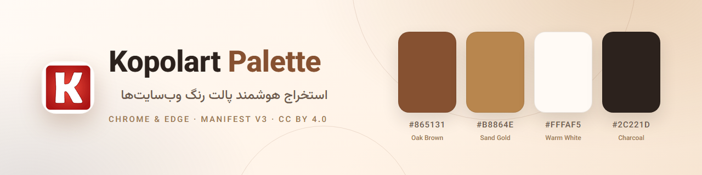
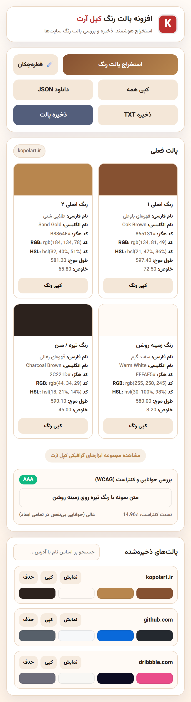
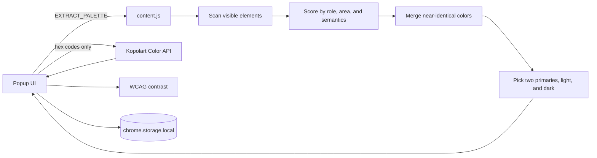

<p align="center">
  
</p>

<h1 align="center">Kopolart Palette</h1>

<p align="center">
  <strong>Extract, save, and inspect any website’s color palette.</strong><br />
  Persian color names, wavelength, and purity from the Kopolart API — plus WCAG contrast — in one popup.
</p>

<p align="center">
  <a href="LICENSE"></a>
  <a href="LICENSE-ARTWORKS"></a>
  <a href="src/manifest.json"></a>
  <a href="#browser-support"></a>
  <a href="https://kopolart.ir"></a>
</p>

<p align="center"><strong>English</strong> · <a href="README.fa.md">فارسی</a></p>

---

Kopolart Palette is a Chrome/Edge extension that reads the computed styles of a
page and distills them into four useful colors: two primaries, a light
background, and a dark text tone. Each color is enriched with Persian and
English names, dominant wavelength, and purity from the Kopolart API, then
checked against WCAG contrast rules.

It is designed for designers, front-end developers, and accessibility
reviewers who want an accurate palette without opening DevTools.

## Screenshot

<p align="center">
  
</p>

## Features

- **Role-aware extraction** — scores colors by background, text, and border
  usage, visual area, element semantics, class/role hints, gradients, and SVG
  fills instead of counting raw occurrences.
- **Useful palette roles** — returns two distinct primary colors, a light
  surface color, and a dark text color, with near-duplicates merged.
- **Kopolart color intelligence** — adds Persian name, English name, wavelength,
  and purity for every color.
- **WCAG contrast check** — shows the text/background ratio with AAA, AA,
  AA Large, or fail ratings.
- **EyeDropper** — samples any pixel on the page when the browser supports the
  EyeDropper API.
- **Copy and export** — copy one color or the whole palette, or export JSON and
  TXT with site metadata.
- **Local palette library** — save palettes, search by site, hostname, URL, or
  hex, and load, copy, or delete them later.
- **Persian-first interface** — RTL layout with the Vazirmatn typeface.
- **Privacy by design** — no accounts, analytics, or tracking; page inspection
  happens locally and only hex codes are sent to the Kopolart API.

## Install

### From a release (recommended)

1. Open the [Releases page](../../releases/latest).
2. Download the latest `kopolart-palette-*.zip` and extract it.
3. Open `chrome://extensions` (Chrome) or `edge://extensions` (Edge).
4. Enable **Developer mode**.
5. Choose **Load unpacked** and select the extracted folder.
6. Pin Kopolart Palette from the extensions menu.

### From source

```bash
git clone https://github.com/kopolart/kopolart-palette.git
cd kopolart-palette
```

Then load the `src/` folder as an unpacked extension, following steps 3–6 above.
There is no build step and there are no runtime dependencies.

## Usage

1. Open any regular `http(s)` website.
2. Click the Kopolart Palette icon and choose **استخراج پالت رنگ**
   (Extract palette).
3. Review the four color cards. Use **کپی رنگ** to copy a color.
4. Use **قطره‌چکان** (EyeDropper) to sample a color directly from the page.
5. Choose **ذخیره پالت** to keep the palette locally, or export it with
   **دانلود JSON** / **ذخیره TXT**.
6. Find saved palettes in the list below. Search by site, host, URL, or hex,
   then view, copy, or delete them.

The contrast panel compares the light background role with the dark text role
and reports the WCAG ratio.

## How it works



1. The popup injects `content.js` into the active tab after you click the
   button, then requests a palette.
2. The content script samples up to 1,200 visible elements, collecting
   background, text, border, gradient, and SVG colors with weights based on
   role and visual importance.
3. Near-identical colors are merged, and the highest-scoring distinct colors
   are assigned to the four palette roles.
4. The popup sends each hex code to `https://kopolart.ir/api/color/{hex}` for
   naming and color-science metadata.
5. The popup renders the palette, computes WCAG contrast, and keeps saved
   palettes in local extension storage.

## Permissions and privacy

| Permission | Why it is needed |
| --- | --- |
| `activeTab` | Grants temporary access to the current tab only after you click the extension. |
| `scripting` | Injects the palette scanner into that tab on demand. |
| `storage` | Saves palettes locally in your browser profile. |
| `https://kopolart.ir/*` | Calls the color lookup API for names, wavelength, and purity. |

The extension does not request access to all sites, does not run on browser
internal pages, and does not load remote code. Page URLs, titles, and content
are never uploaded; only hex codes are sent to the API. See
[PRIVACY.md](PRIVACY.md) for the full policy.

## Browser support

| Browser | Support |
| --- | --- |
| Google Chrome 95+ | Supported |
| Microsoft Edge 95+ | Supported |
| Other Chromium browsers | Expected to work; not officially tested |
| Firefox and Safari | Not supported |

Chrome 95 is the practical minimum because of the EyeDropper API. Palette
extraction itself works on earlier Manifest V3 browsers, but the eyedropper
button will show an unsupported message.

## Limitations

- Browser internal pages (`chrome://`, `edge://`, extension pages, and the
  Chrome Web Store) cannot be scanned.
- Canvas, video, and cross-origin iframe content is not sampled.
- Enrichment requires an internet connection. Without it, the palette still
  works but name, wavelength, and purity fields show `-`.
- Saved palettes are local to the current browser profile. They are not synced
  between devices.
- Color selection is heuristic. Sites with unusual styling or very few colors
  may fall back to a default palette.

## Project structure

```text
.
├── .github/
│   ├── ISSUE_TEMPLATE/
│   ├── workflows/
│   │   ├── ci.yml
│   │   └── release.yml
│   ├── dependabot.yml
│   └── PULL_REQUEST_TEMPLATE.md
├── docs/
│   ├── screenshots/
│   ├── banner.png
│   ├── social-preview.png
│   ├── PUBLISHING.md
│   └── STORE_LISTING.md
├── scripts/
│   └── check.mjs
├── src/                     # load this folder as the unpacked extension
│   ├── assets/
│   │   ├── fonts/
│   │   └── icons/
│   ├── content.js
│   ├── LICENSE
│   ├── LICENSE-ARTWORKS
│   ├── manifest.json
│   ├── NOTICE
│   ├── popup.css
│   ├── popup.html
│   └── popup.js
├── CHANGELOG.md
├── CODE_OF_CONDUCT.md
├── CONTRIBUTING.md
├── LICENSE                  # MIT (source code)
├── LICENSE-ARTWORKS         # CC BY 4.0 (icons, banner, screenshots)
├── NOTICE
├── PRIVACY.md
├── README.fa.md
└── SECURITY.md
```

## Development

Requirements: Node.js 20+ for repository checks. The extension itself has no
build step and no dependencies.

```bash
npm run check
```

The check script verifies the manifest, version consistency, required files,
local references in the popup, JavaScript syntax, and license notices. It runs
in CI on every push and pull request.

After editing, reload the extension from `chrome://extensions` and reopen the
popup. See [CONTRIBUTING.md](CONTRIBUTING.md) for coding guidelines and the
manual test checklist.

## Release

1. Update the version in both `src/manifest.json` and `package.json`.
2. Update `CHANGELOG.md`.
3. Commit, then tag and push:

   ```bash
   git tag -a v1.1.1 -m "v1.1.1"
   git push origin v1.1.1
   ```

The release workflow verifies that the tag matches the manifest version,
builds `kopolart-palette-<version>.zip` from `src/`, and publishes a GitHub
release. See [docs/PUBLISHING.md](docs/PUBLISHING.md) for the complete
publishing checklist.

## Contributing

Issues and pull requests are welcome. Please read
[CONTRIBUTING.md](CONTRIBUTING.md) and the
[Code of Conduct](CODE_OF_CONDUCT.md) first. Security issues should follow
[SECURITY.md](SECURITY.md), not the public issue tracker.

## License and attribution

Kopolart Palette uses a split license:

- **Source code — [MIT](LICENSE).** Use, modify, and redistribute the code,
  including commercially, as long as the copyright and permission notice are
  kept.
- **Artwork and visual assets — [CC BY 4.0](LICENSE-ARTWORKS).** The extension
  icons, banner, screenshots, and social preview may be reused with
  attribution.
- **Kopolart color metadata — CC BY 4.0.** Persian/English names, wavelength,
  and purity returned by the Kopolart API require attribution when
  redistributed.

**Attribution for artwork and color data.** When you share the artwork, a
modified version, or a product that substantially uses the Kopolart color
metadata, include wording similar to:

```text
"Kopolart Palette" artwork by Kopolart (https://kopolart.ir),
licensed under CC BY 4.0 (https://creativecommons.org/licenses/by/4.0/).
Color metadata is provided by the Kopolart API (https://kopolart.ir).
```

If you modified the artwork, say so. Do not imply that Kopolart endorses your
use. The MIT License does not require attribution beyond keeping the copyright
and permission notice with copies of the code.

- **Kopolart API** — color names, wavelength, and purity data come from
  `https://kopolart.ir/api/color/{hex}` and require the attribution above when
  redistributed. See [NOTICE](NOTICE).
- **Vazirmatn** — Copyright 2015 The Vazirmatn Project Authors, licensed under
  the SIL Open Font License 1.1. The full text is in
  [`src/assets/fonts/OFL.txt`](src/assets/fonts/OFL.txt).
- **Trademarks** — neither license grants rights to the Kopolart name or logo.

Kopolart Palette is not affiliated with the websites you scan. Color names and
measurements are provided for design assistance, not as scientific
measurements.

---

<p align="center">Made with care by <a href="https://kopolart.ir">Kopolart</a>.</p>
